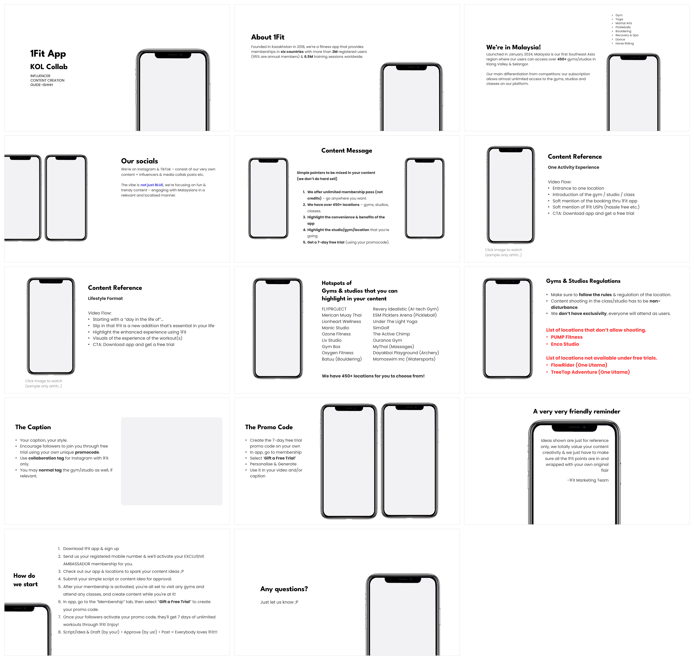

# 1Fit x KOL PPT 模板

照着 `1Fit x KOLs Collabs 2025.pdf`（Canva 导出，1440 × 810 pt）复刻的 PowerPoint 模板。
配色、字号、行距、页边距、手机样机的位置都是从原 PDF 里逐页量出来的，换算到标准 16:9
幻灯片（13.333 × 7.5 in）后一比一还原。



## 文件清单

| 文件 | 用途 |
| --- | --- |
| `dist/1Fit-KOL-Template.pptx` | 14 页示例稿，每页演示一个版式。直接改字就能用 |
| `dist/1Fit-KOL-Template.potx` | PowerPoint 模板文件。双击会新建一份空白演示文稿 |
| `fonts/` | League Spartan + Poppins 字体（SIL OFL 协议，可自由分发） |
| `assets/phone-frame.png` | 从原 PDF 里抠出来的透明 iPhone 边框，屏幕区域是镂空的 |
| `build_template.py` | 生成上面两个文件的脚本，改设计改这里 |
| `preview/layouts.png` | 14 个版式的缩略图总览 |

## 开始使用

1. **先装字体**：把 `fonts/` 里的 9 个 `.ttf` 全部安装（macOS 双击 → 安装字体；
   Windows 右键 → 为所有用户安装）。不装的话 PowerPoint 会回退到系统默认字体，
   排版会明显走样。
2. **选一种方式**
   - 想在现成内容上改：打开 `dist/1Fit-KOL-Template.pptx`，删掉用不上的页。
   - 想从零开始：双击 `dist/1Fit-KOL-Template.potx`，然后用「开始 → 新建幻灯片」
     挑版式。
3. **换页面版式**：选中幻灯片 →「开始 → 版式」，14 个版式按 `01`–`14` 编号排列。

### 关于字体

原稿用的是 **League Spartan Bold**（标题）和 **Now**（正文）。League Spartan 是免费字体，
已经打包在 `fonts/` 里；Now 是商业字体，这里用几何感最接近的免费字体 **Poppins** 代替。

如果你买了 Now 的授权，想换回原字体，重新生成一遍就行：

```bash
python3 build_template.py --body-font "Now"
```

字体是写在主题（Theme）里的，改完之后所有版式和已有文字都会跟着变。

## 设计规范

### 配色

| 名称 | 色值 | 主题位置 | 用在哪 |
| --- | --- | --- | --- |
| Ink | `#000000` | 文字/背景 1 | 所有标题 |
| Body | `#333333` | 文字/背景 2 | 正文 |
| 1Fit Blue | `#524EDE` | 着色 1 | 品牌强调词、超链接 |
| Deep Blue | `#0032A2` | 着色 2 | 标注箭头 |
| Teal | `#5CE1E6` | 着色 3 | 指示箭头、高亮 |
| Alert Red | `#FF3131` | 着色 4 | 禁止拍摄 / 不可用场馆 |
| Grey | `#8E8E93` | 着色 6 | 图注、辅助说明 |
| Screen | `#F2F2F4` | 背景 2 | 空图片框的底色 |

这些都进了主题调色板，在 PowerPoint 的取色盘第一行就能直接点到。

### 字号（pt）

| 用途 | 字号 | 字体 | 行距 |
| --- | --- | --- | --- |
| 封面主标题 | 44 | League Spartan Bold | 1.00 |
| 章节标题 | 33 | League Spartan Bold | 1.00 |
| 页面标题 | 29 | League Spartan Bold | 1.00 |
| 多行标题 | 26 | League Spartan Bold | 1.27 |
| 醒目提示 | 20 | Poppins Bold | 1.49 |
| 列表 | 18 | Poppins | 1.49 |
| 正文 | 17 | Poppins | 1.49 |
| 小字 / 图注 | 15 | Poppins Light | 1.39 |
| 侧边清单 | 12.5 | Poppins | 1.36 |

行距用的是绝对磅值（`spcPts`）而不是百分比。百分比行距会按各家字体自己的默认行高来算，
在 PowerPoint、Keynote、Google Slides 里结果都不一样；写死磅值才能到处都和原稿对齐。

### 版式一览

| # | 名称 | 结构 |
| --- | --- | --- |
| 01 | 封面 Cover | 左标题 + 副标题 + 三行小字，右侧出血手机 |
| 02 | 标题正文 · 右手机 | 左标题 + 一段正文，右下角出血手机 |
| 03 | 标题正文 · 右侧清单 | 右上项目清单 + 左标题 + 两段正文 + 手机 |
| 04 | 标题正文 · 左双手机 | 左侧两台出血手机，右标题 + 正文 |
| 05 | 居中标题 · 双手机列表 | 居中标题 + 引导句 + 编号列表，左右各一台手机 |
| 06 | 左手机 · 右内容列表 | 左手机 + 图注，右标题 + 小标题 + 项目列表 |
| 07 | 左手机 · 双栏清单 | 左手机，右三行标题 + 双栏清单 + 小结 |
| 08 | 左手机 · 规则与禁令 | 左手机，右规则列表 + 红色禁令区块 |
| 09 | 左文 · 右大图 | 左标题 + 列表，右侧大图占位框 |
| 10 | 左文 · 双手机演示 | 左标题 + 步骤列表，右侧两台竖版手机 |
| 11 | 居中标题 · 手机内引言 | 居中标题 + 一台大手机，引言排在屏幕里 |
| 12 | 左标题 · 右编号步骤 | 左侧两行标题 + 右侧长编号流程，左下角出血手机 |
| 13 | 结尾页 Closing | 与封面同构的收尾页 |
| 14 | 空白 Blank | 只有白底，自由发挥 |

### 手机样机

`assets/phone-frame.png` 是原 PDF 里那个 iPhone 边框，屏幕区域透明。每个带手机的版式里
都已经摆好了：

- 边框图本身是版式上的装饰图，不用管；
- 屏幕位置放了一个**图片占位符**，点一下就能塞截图进去，会自动裁切成圆角贴合屏幕；
- 空着的时候屏幕显示浅灰 `#F2F2F4`，不会是刺眼的纯白；
- 例外是第 11、12 号版式：那两页的手机屏幕在原稿里是放文字和留白的，所以给了纯白底、
  没有图片占位符。

想自己摆一台手机：插入 `assets/phone-frame.png`，按住 Shift 等比缩放，截图放在它下层、
四边各内缩约 8.4%（宽）/ 4.0%（高）即可对齐屏幕。

## 重新生成

改完 `build_template.py` 之后：

```bash
pip install python-pptx
cd ppt-template
python3 build_template.py
```

脚本做的事：

1. 把 python-pptx 自带主题的调色板和字体方案换成 1Fit 的；
2. 重写母版（白底 + 标题/正文默认样式）；
3. 复用 11 个内置版式部件、再克隆 3 个，逐个替换成上表里的 14 个版式；
4. 往每个版式里嵌入手机边框图和屏幕图片占位符；
5. 生成 14 页示例稿，另存一份只带封面的 `.potx`。

常用参数：

```bash
python3 build_template.py --heading-font "League Spartan" --body-font "Poppins" --name 1Fit-KOL-Template
```

## 已知限制

- PowerPoint 不会把字体打包进 `.pptx`，所以发给别人之前记得让对方也装 `fonts/` 里的字体，
  或者导出 PDF。
- 封面、结尾页和第 04、12 号版式的手机是**故意出血**到画布外的，和原稿一致；在
  PowerPoint 里编辑时看到手机超出边界属于正常现象。
- `preview/layouts.png` 是用 LibreOffice 渲染的，实际在 PowerPoint 里字体渲染会更细腻。
